# TryHackMe: Summit Write-Up

This write-up covers the Summit room on TryHackMe:

https://tryhackme.com/room/summit

The lab is based on the Pyramid of Pain, where each level represents increasingly effective ways to disrupt an adversary. The goal is to identify indicators and apply defensive actions that increase the attacker’s cost of operation.

## Overview

The Pyramid of Pain consists of:

    Hash Values

    IP Addresses

    Domain Names

    Network / Host Artifacts

    Tools

    TTPs (Tactics, Techniques, Procedures)

## Question 1

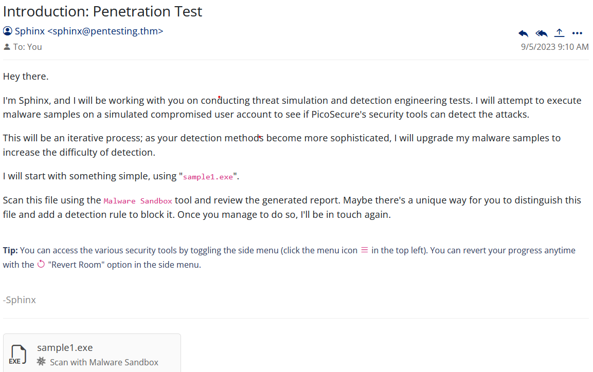

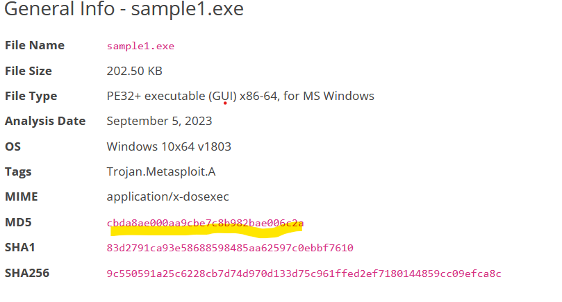

From the analysis report, a suspicious file hash (MD5) is highlighted.

    Indicator identified: File hash (MD5)

    Action: Block the hash

This corresponds to the lowest level of the Pyramid of Pain (Hash Values).

By blocking the hash, the malware is prevented from executing, which yields the first flag.

## Question 2

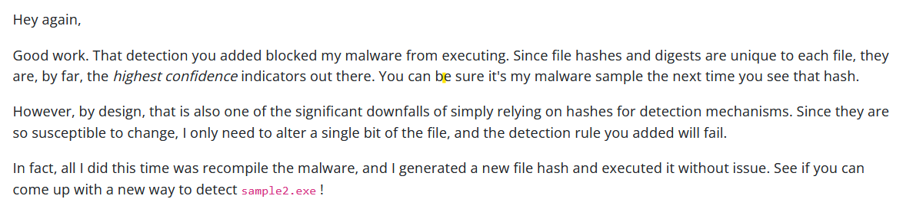
as per the questions the adversary changed the hash value then the above step wont work we need to find another way to block the adversary

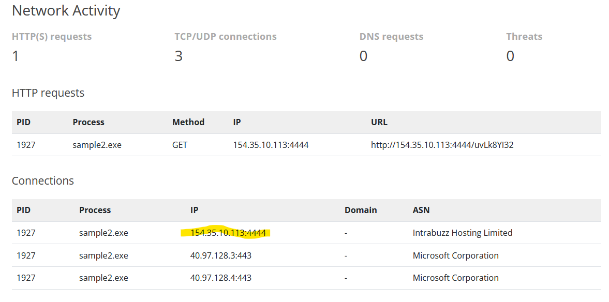
From the analysis:

    Suspicious HTTP request from sample2.exe

    IP address observed: 154.35.10.113

    ASN: Intrabuzz Hosting Limited

    Indicator identified: IP address

    Action: Block outbound traffic to this IP via firewall

This aligns with the IP Address level of the Pyramid of Pain.

Blocking the IP successfully stops the communication and provides the second flag.

## Question 3

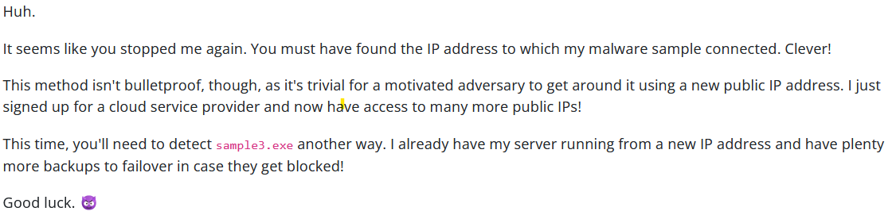

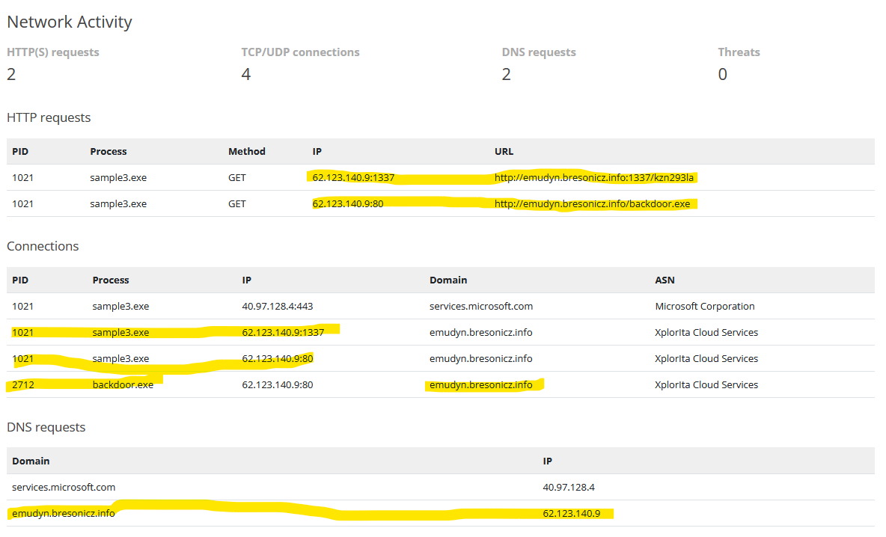
The attacker adapts by using:

    Different IP: 62.123.140.9

    Multiple ports

    Multiple processes (e.g., backdoor.exe)

Observation:

    Same infrastructure reused via domain resolution

    Indicator identified: Domain

    Action: Block the domain instead of individual IPs

This corresponds to the Domain Names level of the Pyramid of Pain.

Blocking the domain is more effective because it prevents communication even if IPs or ports change. 

## Question 4

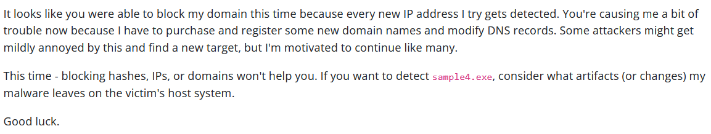

In this one he is already hinting that first 3 pyramid of pain tactics wont work so i guessed it could be either network artifact or host artifact i should be looking into.

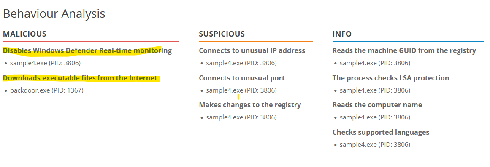

according to this we can see that after disabling windows defender it downloads an malicious executable 

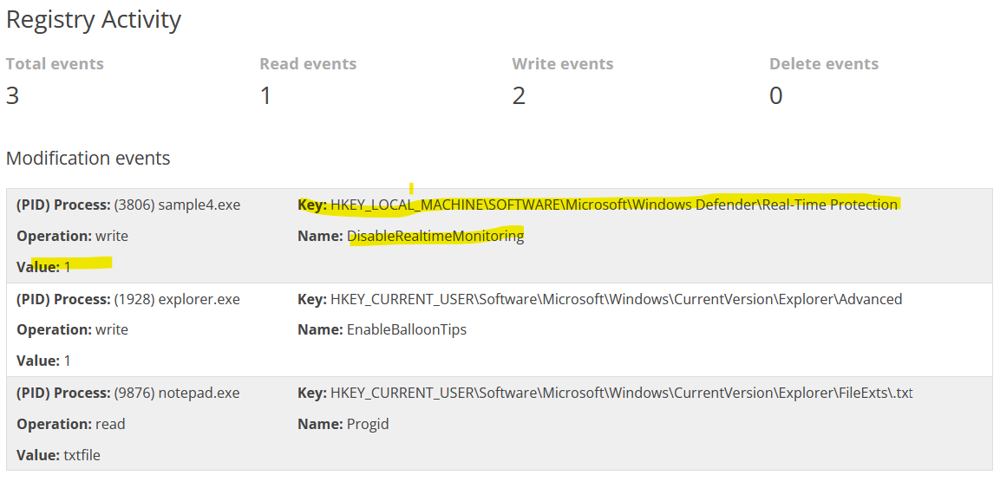

according to this we can see the details for the registry modification i just add the registry modification values in the sigma ruler and i got the fourth flag 

## Question 5

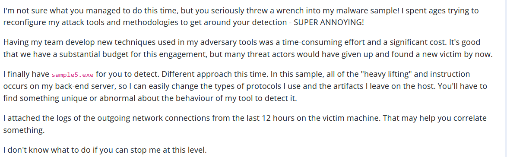
this one looks like a tools tactics in pyramid of pain and command and control in MITRE

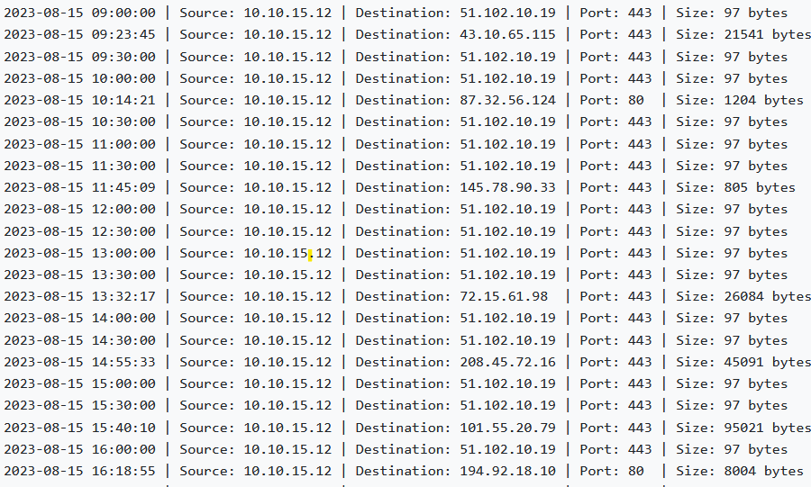
Analysis shows:

    Repeated connections every 30 minutes

    Destination IP: 51.102.10.19

    Port: 443

    Consistent beaconing pattern

Initial attempt:

    Detection based on IP, port, and data size

Improved approach:

    Remove dependency on IP and port (since attackers can rotate them)

    Focus on behavior:

        Regular interval communication

        Consistent connection patterns

    Indicator identified: Command-and-Control (C2) behavior

    Action: Create a behavior-based Sigma rule mapped to MITRE ATT&CK (Command and Control)

This reflects higher-level detection beyond static indicators.

## Question 6

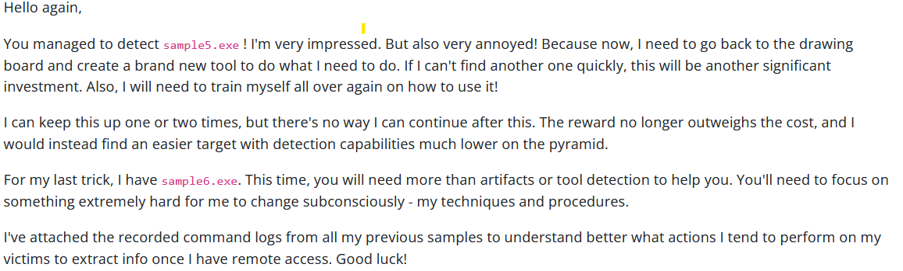
this one looks like a tools tactics in pyramid of pain and command and control in MITRE

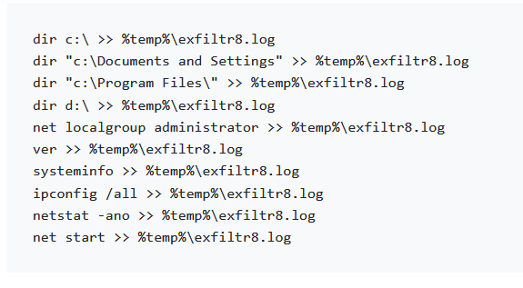
Analysis shows:

    File created: %temp%\exfiltr8.log

    Sensitive data collected:

        System info

        Program files

        Network details

    Action:

        Detect file creation in temp directory

        Monitor suspicious file naming patterns (exfiltr8.log)

        Map to MITRE ATT&CK (Exfiltration / Command & Control)

A Sigma rule was created based on:

    File path

    File name

    File modification behavior

This represents detection at the Tools / TTP level, which is the most effective layer in the Pyramid of Pain.

